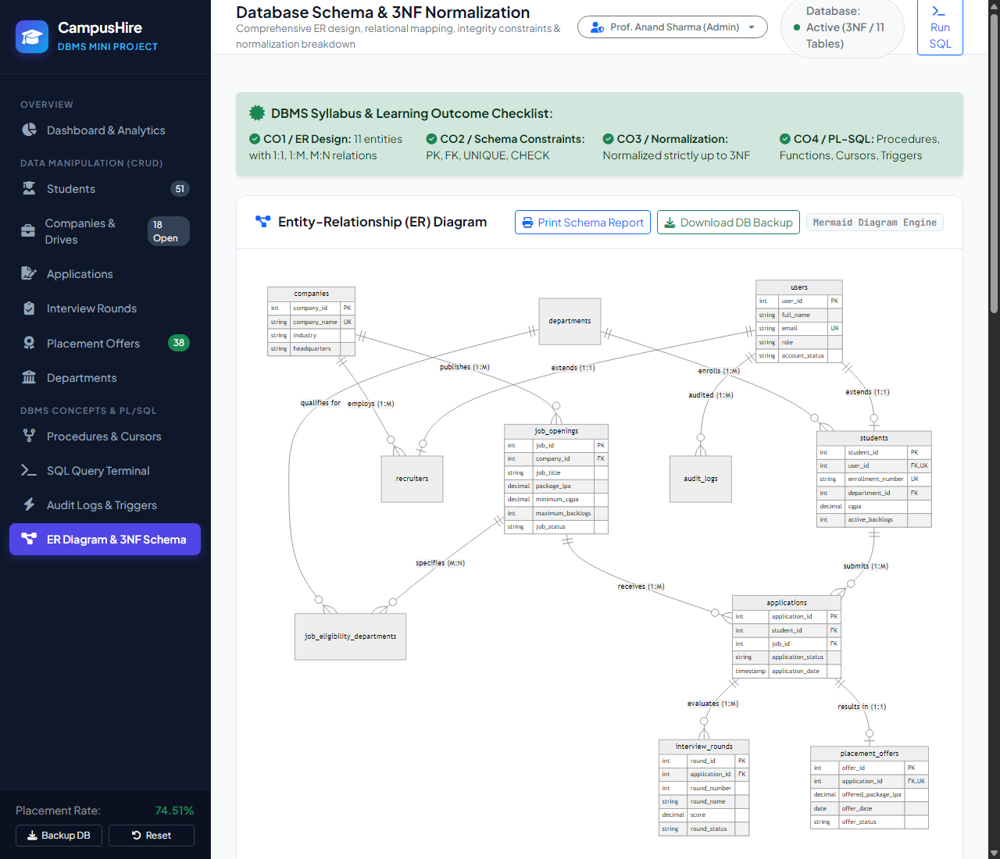
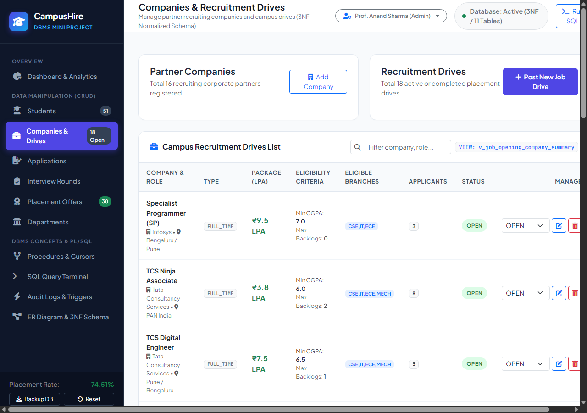
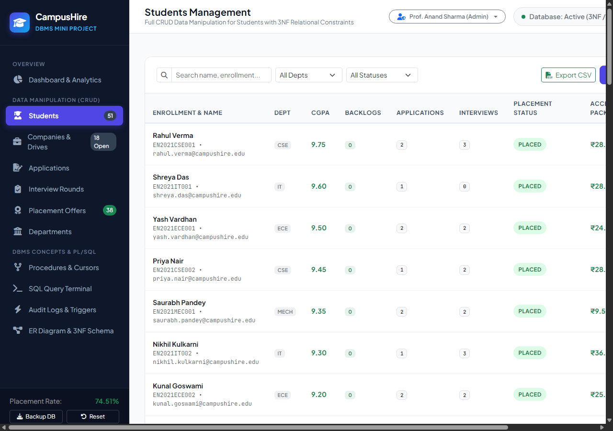
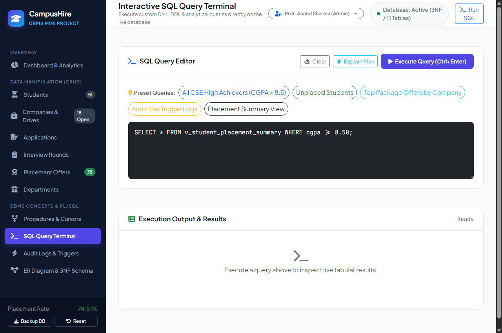
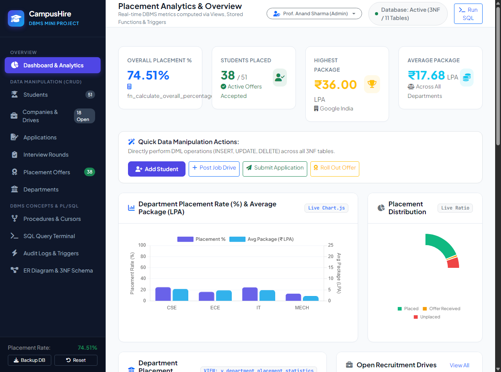
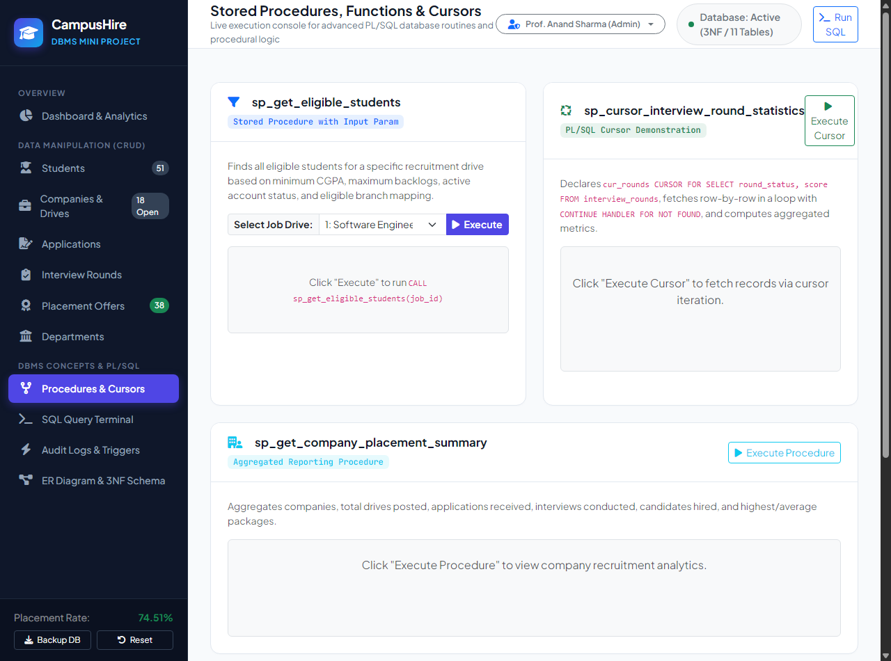
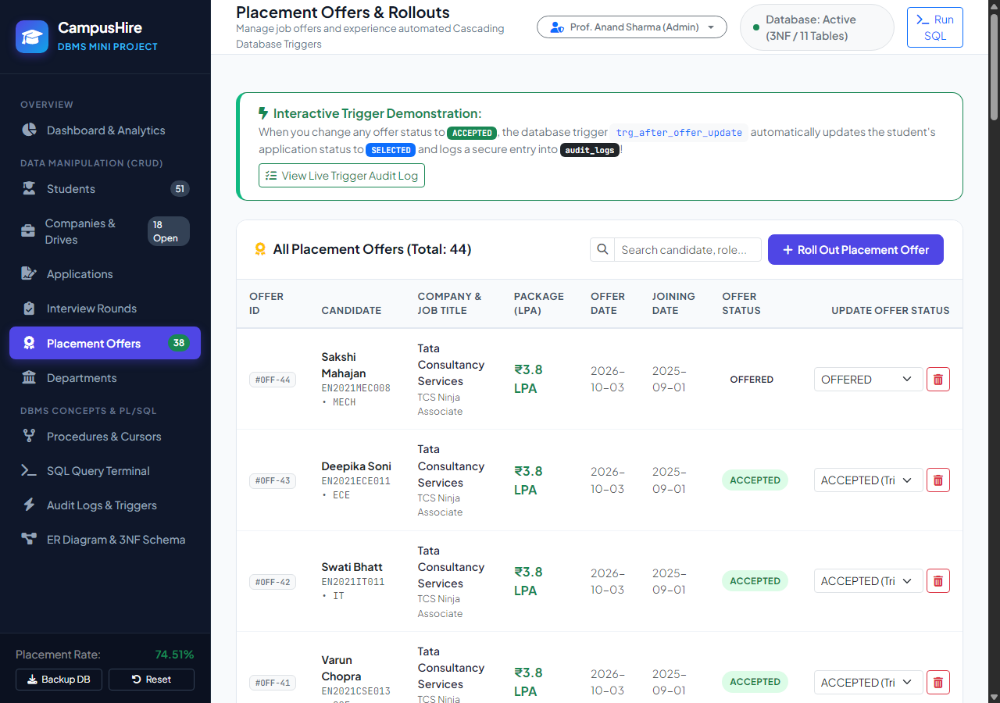
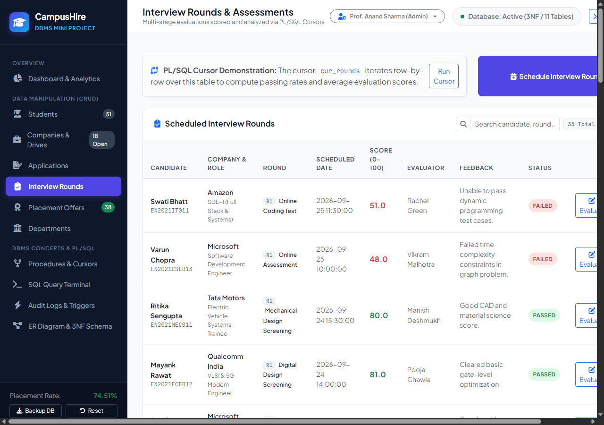
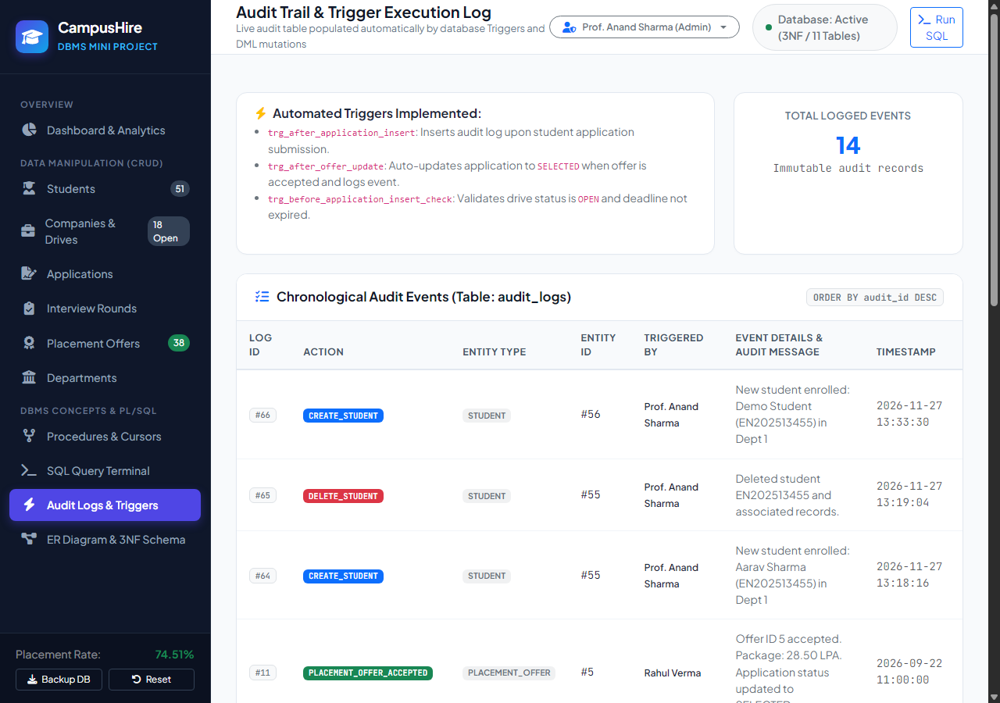
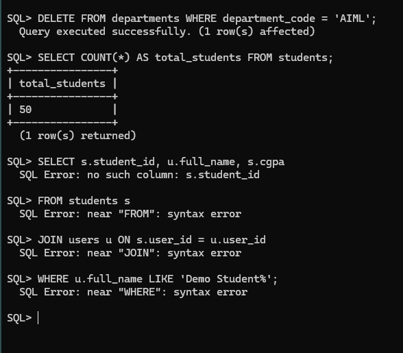

# Data Engineering Mini Project
## Report
### on
# College Placement and Recruitment Management System
### (CampusHire)

<div align="center">


### **D. Y. PATIL COLLEGE OF ENGINEERING, AKURDI, PUNE – 44.**
*(Autonomous Institute with effect from the Academic Year 2024–25)*

---

### **Submitted By**

| Student Name | Exam Seat No. |
| :--- | :--- |
| **Mr. Pushkar Kailash Vyas** | TY2627COA047 |
| **Mr. Sanket Uttam Baviskar** | TY2627COA052 |
| **Mr. Nilesh Jitendra Kuwar** | TY2627COA053 |
| **Mr. Nikhil Datta Bansode** | TY2627COA054 |

---

### **Under the Guidance of**
**Ms. Farhina S. Sayyad**  
*Subject In-charge & Project Guide*

In partial fulfillment for the award of the Degree of  
**B.Tech in Computer Engineering**  
of  
**SAVITRIBAI PHULE PUNE UNIVERSITY**  
A.Y. 2026–27 | SEM I

**Department of Computer Engineering**  
**D. Y. Patil College of Engineering, Akurdi, Pune – 44.**  
*(Autonomous Institute with effect from the Academic Year 2024-25)*

</div>

---
<div style="page-break-after: always;"></div>

# Certificate

<div align="center">

### **D. Y. Patil College of Engineering, Akurdi, Pune – 44**
*(Autonomous Institute with effect from the Academic Year 2024-25)*  
**Department of Computer Engineering**  
**(2026–2027)**

---

### **Certificate**

</div>

This is to certify that,

- **Mr. Pushkar Kailash Vyas**, Exam Seat No: `TY2627COA047`
- **Mr. Sanket Uttam Baviskar**, Exam Seat No: `TY2627COA052`
- **Mr. Nilesh Jitendra Kuwar**, Exam Seat No: `TY2627COA053`
- **Mr. Nikhil Datta Bansode**, Exam Seat No: `TY2627COA054`

have successfully completed the Mini Project entitled **"College Placement and Recruitment Management System (CampusHire)"** under the guidance of **Ms. Farhina S. Sayyad** in partial fulfillment of the requirements for the Third Year of B.Tech in Computer Engineering under the Savitribai Phule Pune University during the academic year 2026–2027.

<br>

**Date  :** ________________________  
**Place :** Akurdi, Pune  

<br><br>

| __________________________________ | __________________________________ |
| :---: | :---: |
| **Ms. Farhina S. Sayyad** | **Dr. Mrs. D. A. Phalke** |
| Subject In-charge & Project Guide | HoD, Computer Engineering |
| Department of Computer Engineering | Department of Computer Engineering |

---
<div style="page-break-after: always;"></div>

# Acknowledgements

With a deep sense of gratitude, we would like to thank all the people who have lit our path with their kind guidance. We are very grateful to these intellectuals who did their best to help us during our project work.

It is our proud privilege to express a deep sense of gratitude to **Dr. Mrs. P. Malathi**, Principal of DYPCOE Akurdi, Pune-44, for her kind permission and encouragement to complete this project. We remain indebted to **Dr. Mrs. D. A. Phalke**, H.O.D., Computer Engineering Department, for her timely suggestions and valuable guidance throughout the course.

Special gratitude goes to **Ms. Farhina S. Sayyad** for the excellent and precious guidance provided during the completion of this work. We thank all our colleagues for their appreciable help and co-operation. We are also thankful to our parents, who provided their wholehearted support for the successful completion of this project. Lastly, we thank all our friends and everyone directly or indirectly associated with this project work.

<br>

**Mini Project Members:**
- Mr. Pushkar Kailash Vyas
- Mr. Sanket Uttam Baviskar
- Mr. Nilesh Jitendra Kuwar
- Mr. Nikhil Datta Bansode

---
<div style="page-break-after: always;"></div>

# Abstract

The College Placement and Recruitment Management System, named CampusHire, is a normalized, relational database management system designed to automate and streamline the end-to-end campus placement lifecycle. In most college Training and Placement (T&P) Cells, placement data is traditionally maintained using fragmented spreadsheets, which leads to severe issues such as duplicate data, human errors in eligibility filtering, concurrency conflicts, and lack of a reliable audit trail.

CampusHire addresses these challenges by implementing a structured relational database using MySQL 8.0 with the InnoDB storage engine. The system encompasses 11 normalized tables organized in Third Normal Form (3NF), supporting entities such as Students, Departments, Companies, Recruiters, Job Openings, Applications, Interview Rounds, Placement Offers, and Audit Logs. The design enforces entity integrity through primary keys, referential integrity through foreign keys with appropriate cascade rules, and domain integrity through CHECK constraints.

Advanced database constructs including Stored Functions, Stored Procedures, Cursors, Triggers, and Views have been implemented to automate business rules such as eligibility checking, audit logging, status synchronization, and placement analytics. The system provides real-time reporting via 3 analytical views and 14 SQL query reports covering placement rates, department-wise statistics, and company hiring summaries. This project demonstrates end-to-end application of DBMS concepts — from ER modeling and normalization to PL/SQL programming — to a real-world placement management problem.

**Keywords:** Relational Database, Normalization, 3NF, ER Diagram, MySQL, Stored Procedures, Triggers, Cursors, Campus Placement, Recruitment Management.

---
<div style="page-break-after: always;"></div>

# Table of Contents

| Section / Topic | Page No. |
| :--- | :---: |
| **Certificate** | **ii** |
| **Acknowledgements** | **iii** |
| **Abstract** | **iv** |
| **Table of Contents** | **v** |
| **List of Abbreviations** | **vi** |
| **List of Figures** | **vii** |
| **List of Tables** | **viii** |
| **Chapter 1 — Introduction** | **1** |
| &nbsp;&nbsp;&nbsp;&nbsp;1.1 Overview | 1 |
| &nbsp;&nbsp;&nbsp;&nbsp;1.2 Aim / Motivation | 1 |
| &nbsp;&nbsp;&nbsp;&nbsp;1.3 Objectives | 2 |
| &nbsp;&nbsp;&nbsp;&nbsp;1.4 Organization of Report | 2 |
| **Chapter 2 — Literature Survey** | **3** |
| **Chapter 3 — Problem Statement** | **4** |
| &nbsp;&nbsp;&nbsp;&nbsp;3.1 Background | 4 |
| &nbsp;&nbsp;&nbsp;&nbsp;3.2 The Problem (5 W's Analysis) | 4 |
| &nbsp;&nbsp;&nbsp;&nbsp;3.3 Proposed Solution | 5 |
| **Chapter 4 — Software Requirements Specification** | **6** |
| &nbsp;&nbsp;&nbsp;&nbsp;4.1 Hardware Requirements | 6 |
| &nbsp;&nbsp;&nbsp;&nbsp;4.2 Software Requirements | 6 |
| **Chapter 5 — System Design** | **7** |
| &nbsp;&nbsp;&nbsp;&nbsp;5.1 ER Diagram | 7 |
| &nbsp;&nbsp;&nbsp;&nbsp;5.2 Relational Schema & Data Dictionaries | 9 |
| &nbsp;&nbsp;&nbsp;&nbsp;5.3 Normalization (UNF to 3NF) | 14 |
| &nbsp;&nbsp;&nbsp;&nbsp;5.4 Advanced Database Constructs | 17 |
| **Chapter 6 — Conclusion and Future Scope** | **23** |
| &nbsp;&nbsp;&nbsp;&nbsp;6.1 Conclusion | 23 |
| &nbsp;&nbsp;&nbsp;&nbsp;6.2 Future Scope | 24 |
| **References** | **25** |

---
<div style="page-break-after: always;"></div>

# List of Abbreviations

| Abbreviation | Full Form |
| :--- | :--- |
| **DBMS** | Database Management System |
| **RDBMS** | Relational Database Management System |
| **ER** | Entity-Relationship |
| **SQL** | Structured Query Language |
| **PL/SQL** | Procedural Language / Structured Query Language |
| **1NF** | First Normal Form |
| **2NF** | Second Normal Form |
| **3NF** | Third Normal Form |
| **UNF** | Unnormalized Form |
| **PK** | Primary Key |
| **FK** | Foreign Key |
| **DML** | Data Manipulation Language |
| **DDL** | Data Definition Language |
| **T&P** | Training and Placement |
| **CGPA** | Cumulative Grade Point Average |
| **LPA** | Lakhs Per Annum |
| **CRUD** | Create, Read, Update, Delete |
| **RBAC** | Role-Based Access Control |

---

# List of Figures

| Figure No. | Description | Section |
| :---: | :--- | :---: |
| **Figure 1** | ER Diagram — CampusHire Entity-Relationship Model (MySQL Workbench) | Section 5.1 |
| **Figure 2** | Schema Architecture — Table Relationship Overview & Module Directory | Section 5.2 |
| **Figure 3** | Normalization Flow — UNF to 3NF Pipeline | Section 5.3 |
| **Figure 4** | Student Profile Dossier & Placement Records Management Interface | Section 5.2 |
| **Figure 5** | Campus Recruitment Drives & Partner Company Management Interface | Section 5.2 |
| **Figure 6** | Interactive SQL Query Terminal with Real-time Query Execution & Explain Plan | Section 5.4.2 |
| **Figure 7** | Stored Procedures & Explicit Cursor Execution Console | Section 5.4.6 |
| **Figure 8** | Placement Offers Rollout & Automatic Trigger Status Cascading | Section 5.4.7 |
| **Figure 9** | Multi-Stage Interview Round Evaluation & Scoring Console | Section 5.4.7 |
| **Figure 10** | System Audit Trail Logs (Automated Trigger Execution History) | Section 5.4.7 |
| **Figure 11** | Direct SQLite Database CLI Terminal Session (Live Proof Execution) | Section 5.4.8 |
| **Figure 12** | Real-Time Analytics Dashboard & Dynamic Chart.js Placement Visualizations | Section 5.4.3 |

---

# List of Tables

| Table No. | Description | Section |
| :---: | :--- | :---: |
| **Table 1** | Unnormalized Placement Spreadsheet (UNF) | Section 5.3 |
| **Table 2** | Entity Definitions & Primary Keys | Section 5.1 |
| **Table 3** | Relationship Cardinality Summary | Section 5.1 |
| **Table 4** | Functional Dependencies Summary | Section 5.3 |
| **Table 5** | Data Dictionary — `users` | Section 5.2 |
| **Table 6** | Data Dictionary — `students` | Section 5.2 |
| **Table 7** | Data Dictionary — `companies` | Section 5.2 |
| **Table 8** | Data Dictionary — `job_openings` | Section 5.2 |
| **Table 9** | Data Dictionary — `applications` | Section 5.2 |
| **Table 10** | Data Dictionary — `interview_rounds` | Section 5.2 |
| **Table 11** | Data Dictionary — `placement_offers` | Section 5.2 |
| **Table 12** | Project File Structure | Section 5.4.8 |

---
<div style="page-break-after: always;"></div>

# Chapter 1: Introduction

### 1.1 Overview
A college Training and Placement (T&P) Cell is one of the most critical administrative units in any engineering institution. It acts as the bridge between graduating students and prospective employers, managing thousands of records relating to student academic profiles, company visit schedules, application submissions, interview evaluations, and final offer letters.

Traditionally, placement management has relied on manual spreadsheets and disconnected tools, leading to significant operational inefficiencies. A well-designed database system can replace these fragmented processes with a centralized, consistent, and reliable data management infrastructure.

CampusHire is a fully normalized relational database management system developed using MySQL 8.0. It is designed to model, automate, and streamline every stage of the placement lifecycle — from student registration and academic eligibility verification to multi-round interview management and final placement offer tracking.

### 1.2 Aim / Motivation
The primary aim of this project is to design and implement a comprehensive relational database system for managing college campus placements. The motivation stems from real-world challenges observed in T&P cells:
- **Duplicate Data & Discrepancies:** Multiple versions of candidate lists and resumes circulate among coordinators leading to redundancy and inconsistencies.
- **Human Errors in Eligibility Filtering:** Manual filtering for CGPA cut-offs, backlog restrictions, and branch eligibility is error-prone.
- **No Audit Trail:** There is no reliable record of when applications were submitted, offers were made, or statuses were changed.
- **Concurrency Conflicts:** Simultaneous updates by multiple coordinators and recruiters cause data integrity issues.

### 1.3 Objectives
- Design a complete Entity-Relationship (ER) model capturing all real-world entities and relationships in the placement domain.
- Convert the ER model into a fully normalized relational schema (up to 3NF), eliminating data redundancy and anomalies.
- Implement the schema in MySQL 8.0 with appropriate PRIMARY KEY, FOREIGN KEY, UNIQUE, and CHECK constraints.
- Perform comprehensive DML operations including multi-table JOINs, GROUP BY aggregations, and subqueries.
- Implement Stored Functions for calculating placement statistics (e.g., overall placement percentage).
- Implement Stored Procedures for parameterized eligibility checking and report generation.
- Implement an explicit Cursor to iterate over interview round data row-by-row.
- Implement Triggers to automate audit logging, status synchronization, and business rule enforcement.
- Create Views for real-time analytical reporting on student placement and department statistics.

### 1.4 Organization of Report
The rest of this report is organized as follows:
- **Chapter 2 (Literature Survey):** Comparison of existing placement management approaches and tools.
- **Chapter 3 (Problem Statement):** Detailed analysis of the problem being solved.
- **Chapter 4 (Software Requirements Specification):** Hardware and software prerequisites.
- **Chapter 5 (System Design):** Complete ER diagram, relational schema, normalization, and PL/SQL constructs.
- **Chapter 6 (Conclusion and Future Scope):** Summary of achievements and future enhancements.

---
<div style="page-break-after: always;"></div>

# Chapter 2: Literature Survey

The following table presents a comparative survey of existing placement and HR management systems, analyzed against the features implemented in CampusHire:

| Feature | Excel / Spreadsheet | College ERP | LinkedIn Talent | Oracle HCM | CampusHire (Proposed) |
| :--- | :---: | :---: | :---: | :---: | :---: |
| **Centralized Relational DB** | ✗ | Partial | ✓ | ✓ | **✓** |
| **ER Modeling & 3NF** | ✗ | Partial | ✗ | ✓ | **✓** |
| **Automated Eligibility Filter** | ✗ | Partial | ✓ | ✓ | **✓** |
| **Multi-Round Interview Tracking** | ✗ | Partial | ✓ | ✓ | **✓** |
| **Stored Procedures & Triggers** | ✗ | ✓ | ✗ | ✓ | **✓** |
| **Audit Trail / Logging** | ✗ | Partial | ✓ | ✓ | **✓** |
| **Department-wise Analytics** | Manual | ✓ | Partial | ✓ | **✓** |
| **Open Source / Free Tool** | ✓ | ✗ | ✗ | ✗ | **✓ (MySQL)** |
| **Academic / Teaching Value** | ✓ | ✗ | ✗ | ✗ | **✓** |

### Observations:
- Spreadsheets offer zero data integrity guarantees and fail at scale with growing student and company data.
- Commercial ERP systems (like Oracle HCM) are feature-rich but expensive and inaccessible for academic study.
- CampusHire uniquely combines full academic transparency (hand-crafted SQL, visible schema logic) with the functional richness of enterprise systems, making it ideal for both learning and practical deployment.

---
<div style="page-break-after: always;"></div>

# Chapter 3: Problem Statement

### 3.1 Background
In college and university environments, the Training and Placement (T&P) Cell handles high-stakes operations connecting students, department heads, visiting corporations, and hiring managers. This process involves managing hundreds of student records, dozens of company visits per academic year, and thousands of individual application transactions.

### 3.2 The Problem (5 W's Analysis)
- **Who is affected?** Students seeking jobs, placement coordinators managing drives, company recruiters evaluating candidates, and department heads tracking branch-wise statistics.
- **What is the issue?** Placement data maintained using fragmented spreadsheets leads to duplicate data, inconsistencies, human errors in eligibility filtering, concurrency conflicts, and absence of an audit trail.
- **When does it occur?** These problems are most severe during peak placement season (August–February) when multiple companies visit simultaneously and high transaction volumes stress the manual system.
- **Where does it occur?** In the Training and Placement Cell — specifically at the points of student registration, company drive posting, application collection, interview scheduling, and offer issuance.
- **Why must it be fixed?** Incorrect eligibility leads to rejected students losing career opportunities. Unreliable data undermines trust between the institution and recruiting companies. The absence of analytics prevents effective planning for future placement seasons.

### 3.3 Proposed Solution
CampusHire — a normalized relational database system in MySQL 8.0 — eliminates all the above issues through structured schema design, enforced constraints, automated PL/SQL logic, and real-time analytics.

---
<div style="page-break-after: always;"></div>

# Chapter 4: Software Requirements Specification

### 4.1 Hardware Requirements
| Component | Minimum Specification |
| :--- | :--- |
| **Processor** | Intel Core i3 / AMD Ryzen 3 (or equivalent), 1.8 GHz+ |
| **RAM** | 4 GB (8 GB recommended) |
| **Storage** | 10 GB free disk space |
| **Display** | 1024 × 768 resolution or higher |
| **Network** | LAN/Internet (for multi-user access) |

### 4.2 Software Requirements
| Software | Version | Purpose |
| :--- | :--- | :--- |
| **MySQL Server** | 8.0+ | Core RDBMS engine (InnoDB storage) |
| **MySQL Workbench** | 8.0+ | GUI for schema design, query execution, and ER visualization |
| **Operating System** | Windows 10/11 / Ubuntu 20.04+ | Host platform |
| **Web Browser** | Chrome / Firefox (latest) | phpMyAdmin / Web application access |
| **Python & SQLite** | 3.10+ / SQLite 3 | Zero-configuration local verification and CLI tools |
| **Git** | 2.x | Version control for SQL scripts and codebase |

---
<div style="page-break-after: always;"></div>

# Chapter 5: System Design

### 5.1 ER Diagram
The CampusHire database models a college Training and Placement (T&P) Cell. It tracks students, departments, participating companies, recruiters, campus job postings, departmental eligibility criteria, student applications, multi-stage interview rounds, job offers, and audit logs. The ER diagram is shown in Figure 1 (rendered using MySQL Workbench).

<div align="center">

  
*Figure 1: ER Diagram — CampusHire Entity-Relationship Model (MySQL Workbench)*

</div>

<br>

#### Entity Definitions & Primary Keys [Table 2]
| Entity | Description | Primary Key | Key Attributes |
| :--- | :--- | :--- | :--- |
| **USERS** | Master account table for authentication and RBAC | `user_id` | `email` (Unique), `role`, `password_hash` |
| **DEPARTMENTS** | Academic branches (CSE, IT, ECE, MECH) | `department_id` | `department_code` (Unique), `department_name` |
| **STUDENTS** | Academic profile of registered candidates | `student_id` | `user_id` (1:1), `enrollment_number` (Unique), `cgpa` |
| **COMPANIES** | Organizations conducting recruitment drives | `company_id` | `company_name` (Unique), `industry`, `headquarters` |
| **RECRUITERS** | Representatives of hiring companies | `recruiter_id` | `user_id` (1:1), `company_id` (FK), `designation` |
| **JOB_OPENINGS** | Placement drives and job roles | `job_id` | `company_id` (FK), `package_lpa`, `minimum_cgpa`, `deadline` |
| **JOB_ELIGIBILITY_DEPARTMENTS** | Junction entity resolving M:N between Jobs & Departments | `(job_id, department_id)` | Composite Primary Key |
| **APPLICATIONS** | Student applications for job drives | `application_id` | `student_id` (FK), `job_id` (FK), `(student_id, job_id)` Unique |
| **INTERVIEW_ROUNDS** | Consecutive stages in candidate evaluation | `round_id` | `application_id` (FK), `round_number`, `score` (0-100) |
| **PLACEMENT_OFFERS** | Final employment offer rolled out | `offer_id` | `application_id` (FK, Unique), `offered_package_lpa`, `offer_status` |
| **AUDIT_LOGS** | Immutable system event log | `audit_id` | `user_id`, `action`, `entity_type`, `created_at` |

#### Relationship Cardinality & Business Rules [Table 3]
| Relationship | Cardinality | Enforcement Mechanism |
| :--- | :---: | :--- |
| **USERS → STUDENTS** | 1:1 | `UNIQUE(user_id)` on students |
| **USERS → RECRUITERS** | 1:1 | `UNIQUE(user_id)` on recruiters |
| **DEPARTMENTS → STUDENTS** | 1:N | FK `department_id` in students |
| **COMPANIES → JOB_OPENINGS** | 1:N | FK `company_id` in job_openings |
| **JOB_OPENINGS ↔ DEPARTMENTS** | M:N | Junction table `job_eligibility_departments` |
| **STUDENTS ↔ JOB_OPENINGS (via APPLICATIONS)** | M:N | `UNIQUE(student_id, job_id)` in applications |
| **APPLICATIONS → INTERVIEW_ROUNDS** | 1:N | FK `application_id` in interview_rounds |
| **APPLICATIONS → PLACEMENT_OFFERS** | 1:1 | `UNIQUE(application_id)` in placement_offers |

---

### 5.2 Relational Schema
Formal Notation (Primary Keys underlined, Foreign Keys in italics):
1.  **USERS** (**user_id** [PK], full_name, email [UK], password_hash, role, account_status, created_at, updated_at)
2.  **DEPARTMENTS** (**department_id** [PK], department_name [UK], department_code [UK], description)
3.  **STUDENTS** (**student_id** [PK], *user_id* [FK], enrollment_number [UK], *department_id* [FK], graduation_year, cgpa, active_backlogs, phone, resume_url, profile_status)
4.  **COMPANIES** (**company_id** [PK], company_name [UK], industry, website, company_description, headquarters)
5.  **RECRUITERS** (**recruiter_id** [PK], *user_id* [FK], *company_id* [FK], designation, phone)
6.  **JOB_OPENINGS** (**job_id** [PK], *company_id* [FK], job_title, job_description, job_type, location, minimum_cgpa, maximum_backlogs, package_lpa, application_deadline, drive_date, job_status, *created_by* [FK])
7.  **JOB_ELIGIBILITY_DEPARTMENTS** (**_job_id_** [PK,FK], **_department_id_** [PK,FK])
8.  **APPLICATIONS** (**application_id** [PK], *student_id* [FK], *job_id* [FK], application_date, application_status)
9.  **INTERVIEW_ROUNDS** (**round_id** [PK], *application_id* [FK], round_number, round_name, scheduled_at, score, feedback, round_status, *evaluated_by* [FK])
10. **PLACEMENT_OFFERS** (**offer_id** [PK], *application_id* [FK,UK], offered_package_lpa, offer_date, joining_date, offer_status)
11. **AUDIT_LOGS** (**audit_id** [PK], *user_id* [FK], action, entity_type, entity_id, details, created_at)

<div align="center">

  
*Figure 2: Schema Architecture — Table Relationship Overview & Module Directory*

</div>

<br>

#### Data Dictionaries

##### Table 5: `users`
| Column | Data Type | Nullable | Constraints | Description |
| :--- | :--- | :---: | :--- | :--- |
| `user_id` | INT | NO | PK, AUTO_INCREMENT | Unique user identifier |
| `full_name` | VARCHAR(100) | NO | — | Legal full name |
| `email` | VARCHAR(150) | NO | UNIQUE | Login credential |
| `password_hash` | VARCHAR(255) | NO | — | Bcrypt password hash |
| `role` | ENUM | NO | 'ADMIN','STUDENT','RECRUITER' | Role-based authorization |
| `account_status` | ENUM | NO | DEFAULT 'ACTIVE' | Active state of user |
| `created_at` | TIMESTAMP | NO | DEFAULT CURRENT_TIMESTAMP | Registration time |
| `updated_at` | TIMESTAMP | NO | ON UPDATE CURRENT_TIMESTAMP | Last modified time |

##### Table 6: `students`
| Column | Data Type | Nullable | Constraints | Description |
| :--- | :--- | :---: | :--- | :--- |
| `student_id` | INT | NO | PK, AUTO_INCREMENT | Student primary key |
| `user_id` | INT | NO | UNIQUE, FK → users | 1:1 link to user account |
| `enrollment_number` | VARCHAR(50) | NO | UNIQUE | University Roll No. |
| `department_id` | INT | NO | FK → departments | Enrolled branch |
| `graduation_year` | INT | NO | — | Passing out year |
| `cgpa` | DECIMAL(4,2) | NO | CHECK (0.00–10.00) | Cumulative GPA |
| `active_backlogs` | INT | NO | DEFAULT 0, CHECK (≥0) | Live backlog count |
| `phone` | VARCHAR(20) | YES | — | Contact number |
| `resume_url` | VARCHAR(255) | YES | — | Link to student CV |
| `profile_status` | ENUM | NO | DEFAULT 'VERIFIED' | Verification status |

<div align="center">

  
*Figure 4: Student Profile Dossier & Placement Records Management Interface*

</div>

<br>

##### Table 7: `companies`
| Column | Data Type | Nullable | Constraints | Description |
| :--- | :--- | :---: | :--- | :--- |
| `company_id` | INT | NO | PK, AUTO_INCREMENT | Company primary key |
| `company_name` | VARCHAR(150) | NO | UNIQUE | Official name |
| `industry` | VARCHAR(100) | NO | — | Industry domain |
| `website` | VARCHAR(255) | YES | — | Corporate URL |
| `company_description` | TEXT | YES | — | Overview |
| `headquarters` | VARCHAR(100) | YES | — | Primary city |

##### Table 8: `job_openings`
| Column | Data Type | Nullable | Constraints | Description |
| :--- | :--- | :---: | :--- | :--- |
| `job_id` | INT | NO | PK, AUTO_INCREMENT | Job opening identifier |
| `company_id` | INT | NO | FK → companies | Recruiting company |
| `job_title` | VARCHAR(150) | NO | — | Designation offered |
| `job_type` | ENUM | NO | 'FULL_TIME','INTERNSHIP' | Employment model |
| `location` | VARCHAR(100) | NO | — | Work location |
| `minimum_cgpa` | DECIMAL(4,2) | NO | CHECK (0–10) | Eligibility CGPA |
| `maximum_backlogs` | INT | NO | CHECK (≥0) | Max allowed backlogs |
| `package_lpa` | DECIMAL(6,2) | NO | CHECK (≥0) | Compensation (LPA) |
| `application_deadline` | DATETIME | NO | — | Last date to apply |
| `drive_date` | DATETIME | YES | — | Scheduled drive date |
| `job_status` | ENUM | NO | 'DRAFT','OPEN','CLOSED' | Recruitment status |
| `created_by` | INT | NO | FK → users | Creator/administrator |

<div align="center">

  
*Figure 5: Campus Recruitment Drives & Partner Company Management Interface*

</div>

<br>

##### Table 9: `applications`
| Column | Data Type | Nullable | Constraints | Description |
| :--- | :--- | :---: | :--- | :--- |
| `application_id` | INT | NO | PK, AUTO_INCREMENT | Application identifier |
| `student_id` | INT | NO | FK → students | Candidate |
| `job_id` | INT | NO | FK → job_openings | Job drive |
| `application_date` | TIMESTAMP | NO | DEFAULT CURRENT_TIMESTAMP | Submission timestamp |
| `application_status` | ENUM | NO | 'APPLIED','SHORTLISTED','REJECTED','SELECTED','WITHDRAWN' | Pipeline state |
| *(Constraint)* | — | — | UNIQUE(student_id, job_id) | Prevents duplicate applications |

##### Table 10: `interview_rounds`
| Column | Data Type | Nullable | Constraints | Description |
| :--- | :--- | :---: | :--- | :--- |
| `round_id` | INT | NO | PK, AUTO_INCREMENT | Round primary key |
| `application_id` | INT | NO | FK → applications (CASCADE) | Candidate application |
| `round_number` | INT | NO | — | Sequential round (1, 2, 3…) |
| `round_name` | VARCHAR(100) | NO | — | e.g. "Technical Interview" |
| `scheduled_at` | DATETIME | YES | — | Appointment date & time |
| `score` | DECIMAL(5,2) | YES | CHECK (NULL OR 0–100) | Score out of 100 |
| `feedback` | TEXT | YES | — | Evaluator notes |
| `round_status` | ENUM | NO | 'PENDING','PASSED','FAILED','NOT_ATTENDED' | Stage outcome |
| `evaluated_by` | INT | YES | FK → users (SET NULL) | Evaluator |
| *(Constraint)* | — | — | UNIQUE(application_id, round_number) | One record per round |

##### Table 11: `placement_offers`
| Column | Data Type | Nullable | Constraints | Description |
| :--- | :--- | :---: | :--- | :--- |
| `offer_id` | INT | NO | PK, AUTO_INCREMENT | Offer identifier |
| `application_id` | INT | NO | UNIQUE, FK → applications | Successful application |
| `offered_package_lpa` | DECIMAL(6,2) | NO | CHECK (≥0) | Final package in LPA |
| `offer_date` | DATE | NO | — | Date offer was rolled out |
| `joining_date` | DATE | YES | — | Scheduled joining date |
| `offer_status` | ENUM | NO | 'OFFERED','ACCEPTED','DECLINED','WITHDRAWN' | Candidate decision |

#### Referential Integrity & Cascade Rules
| Rule | Applied On | Rationale |
| :--- | :--- | :--- |
| **ON DELETE RESTRICT** | `departments`→`students`, `companies`→`job_openings`, `students`→`applications` | Prevents accidental deletion of parent records that have dependent child data |
| **ON DELETE CASCADE** | `job_openings`→`job_eligibility_departments`, `applications`→`interview_rounds` | Automatically cleans up weak/dependent entities when parent is deleted |
| **ON DELETE SET NULL** | `evaluated_by` in `interview_rounds`, `user_id` in `audit_logs` | Preserves audit history even if an evaluator's account is deleted |

---

### 5.3 Normalization
Normalization is a formal, systematic database design technique used to organize tables in a RDBMS to minimize data redundancy, prevent data anomalies (Insertion, Update, Deletion), and ensure data integrity through well-defined keys and constraints.

#### Unnormalized State (UNF) & Anomalies [Table 1]
Consider a typical unnormalized placement spreadsheet used in colleges:

| EnrollNo | StudentName | DeptCode | CGPA | JobTitle | Company | Round1 | Round2 | OfferLPA |
| :--- | :--- | :---: | :---: | :--- | :--- | :---: | :---: | :---: |
| EN001 | Rahul Verma | CSE | 9.45 | SDE | Google | 95 | 92.5 | 28.5 |
| EN001 | Rahul Verma | CSE | 9.45 | SDE | Microsoft | 90 | 85.0 | 24.0 |
| EN002 | Priya Nair | CSE | 9.10 | SDE | Google | 98 | 94.0 | 28.5 |

Anomalies present in UNF:
- **Redundancy:** Student name, department name, and company details repeat across rows.
- **Update Anomaly:** If Google changes its website URL, every row must be updated; any missed row creates inconsistency.
- **Insertion Anomaly:** A new department cannot be registered until a student enrolls and applies for a job.
- **Deletion Anomaly:** If Priya Nair's record is deleted, all information about her interview scores is permanently lost.

#### Normalization Flow (Figure 3)
```
Unnormalized Form (UNF)  -->  Contains multi-valued attributes and repeating groups.
         |
         v  [Rule: Ensure atomic values, eliminate repeating groups]
First Normal Form (1NF)  -->  All attributes are atomic. Primary Key established.
         |
         v  [Rule: Eliminate partial functional dependencies on composite keys]
Second Normal Form (2NF) -->  Every non-key attribute is fully functionally dependent on PK.
         |
         v  [Rule: Eliminate transitive functional dependencies]
Third Normal Form (3NF)  -->  Non-key attributes depend ONLY on the primary key!
```

#### First Normal Form (1NF)
A relation R is in 1NF if every attribute value is atomic, there are no repeating groups, and a unique primary key exists for every tuple.

Violations addressed in CampusHire:
- **Multi-Valued Eligible Departments:** Eligible Departments stored as 'CSE, IT, ECE' inside `job_openings` → Decomposed into bridge relation `job_eligibility_departments` with one `(job_id, department_id)` pair per row.
- **Multi-Valued Interview Scores:** Columns `round1_score`, `round2_score`, `round3_score` → Created separate relation `interview_rounds` where each round is an independent atomic record.

#### Second Normal Form (2NF)
A relation R is in 2NF if it is in 1NF and every non-prime attribute is fully functionally dependent on the whole primary key (no partial dependencies).

- `job_eligibility_departments`: Composite PK `(job_id, department_id)` with no non-prime attributes — automatically satisfies 2NF.
- `applications`: Only `application_status` and `application_date` are stored here, both depending on the full `(student_id, job_id)` combination. Student details and job details reside in their own tables.

#### Third Normal Form (3NF)
A relation R is in 3NF if it is in 2NF and there are no transitive dependencies — all non-prime attributes depend directly and exclusively on the primary key (*"Depend on the key, the whole key, and nothing but the key."*).

Transitive Dependencies Eliminated:
- **Case 1 — Student & Department Separation:**  
  `student_id → department_id → department_name, department_code`  
  *Solution:* `departments(department_id, department_name, department_code)` extracted as independent relation. `students` references it via FK `department_id`.
- **Case 2 — Job Opening & Company Separation:**  
  `job_id → company_id → company_name, industry, headquarters`  
  *Solution:* `companies(company_id, company_name, industry, headquarters)` extracted as independent relation.
- **Case 3 — Application & Placement Offer Separation:**  
  `application_id → offer_id → offered_package_lpa, offer_date, offer_status`  
  *Solution:* `placement_offers(offer_id, application_id, offered_package_lpa, offer_status)` extracted.

#### Functional Dependencies Summary [Table 4]
| Relation | Primary Key | Determinant (LHS) | Dependent Attributes (RHS) | Type |
| :--- | :--- | :--- | :--- | :---: |
| `users` | `user_id` | `user_id` | `full_name, email, role, account_status` | Full (3NF) |
| `departments` | `department_id` | `department_id` | `department_name, department_code, description` | Full (3NF) |
| `students` | `student_id` | `student_id` | `user_id, enrollment_number, department_id, cgpa` | Full (3NF) |
| `companies` | `company_id` | `company_id` | `company_name, industry, website, headquarters` | Full (3NF) |
| `recruiters` | `recruiter_id` | `recruiter_id` | `user_id, company_id, designation` | Full (3NF) |
| `job_openings` | `job_id` | `job_id` | `company_id, job_title, package_lpa, minimum_cgpa` | Full (3NF) |
| `job_eligibility` | `(job_id, dept_id)` | `(job_id, dept_id)` | Composite key, no non-prime attributes | Full (3NF) |
| `applications` | `application_id` | `application_id` | `student_id, job_id, application_date, application_status` | Full (3NF) |
| `interview_rounds`| `round_id` | `round_id` | `application_id, round_number, score, round_status` | Full (3NF) |
| `placement_offers`| `offer_id` | `offer_id` | `application_id, offered_package_lpa, offer_date` | Full (3NF) |
| `audit_logs` | `audit_id` | `audit_id` | `user_id, action, entity_type, entity_id` | Full (3NF) |

---

### 5.4 Advanced Database Constructs

#### 5.4.1 Constraints
Domain Integrity (CHECK Constraints):
```sql
ALTER TABLE students ADD CONSTRAINT chk_student_cgpa CHECK (cgpa >= 0.00 AND cgpa <= 10.00);
ALTER TABLE students ADD CONSTRAINT chk_student_backlogs CHECK (active_backlogs >= 0);
ALTER TABLE job_openings ADD CONSTRAINT chk_job_cgpa CHECK (minimum_cgpa >= 0.00 AND minimum_cgpa <= 10.00);
ALTER TABLE job_openings ADD CONSTRAINT chk_job_package CHECK (package_lpa >= 0.00);
ALTER TABLE interview_rounds ADD CONSTRAINT chk_round_score CHECK (score IS NULL OR (score >= 0.00 AND score <= 100.00));
ALTER TABLE placement_offers ADD CONSTRAINT chk_offer_package CHECK (offered_package_lpa >= 0.00);
```

#### 5.4.2 DML Operations
Key DML operations performed on the CampusHire database:

```sql
-- Retrieve all OPEN jobs a student (ID=3) is eligible for
SELECT jo.job_title, c.company_name, jo.package_lpa, jo.minimum_cgpa
FROM job_openings jo
JOIN companies c ON jo.company_id = c.company_id
JOIN job_eligibility_departments jed ON jo.job_id = jed.job_id
JOIN students s ON jed.department_id = s.department_id
WHERE s.student_id = 3  AND jo.job_status = 'OPEN'  AND s.cgpa >= jo.minimum_cgpa  AND s.active_backlogs <= jo.maximum_backlogs;

-- Shortlist a student application
UPDATE applications
SET application_status = 'SHORTLISTED'
WHERE application_id = 12;

-- Department-wise placement statistics
SELECT d.department_name,
       COUNT(DISTINCT s.student_id)  AS total_students,
       COUNT(DISTINCT po.offer_id)   AS placed_students,
       ROUND(COUNT(DISTINCT po.offer_id)*100.0/COUNT(DISTINCT s.student_id),2) AS placement_pct,
       MAX(po.offered_package_lpa)   AS highest_package
FROM departments d
JOIN students s ON d.department_id = s.department_id
LEFT JOIN applications a ON s.student_id = a.student_id
LEFT JOIN placement_offers po ON a.application_id = po.application_id  AND po.offer_status = 'ACCEPTED'
GROUP BY d.department_id, d.department_name;
```

<div align="center">

  
*Figure 6: Interactive SQL Query Terminal with Real-time Query Execution & Explain Plan*

</div>

<br>

#### 5.4.3 Views
| View Name | Description |
| :--- | :--- |
| `v_student_placement_summary` | Summarizes student profile, application counts, interview participation, and placed status. |
| `v_job_opening_company_summary` | Displays drive details, company profile, eligible branches, and total applicant counts. |
| `v_department_placement_statistics` | Branch-wise total students, placed count, placement %, highest package, and average package. |

<div align="center">

  
*Figure 12: Real-Time Analytics Dashboard & Dynamic Chart.js Placement Visualizations*

</div>

<br>

#### 5.4.4 Stored Function
`fn_calculate_overall_placement_percentage()` — Computes the overall campus placement percentage:

$$	ext{Placement } \% = \left(rac{	ext{Distinct students with } \ge 1 	ext{ ACCEPTED offer}}{	ext{Total registered active students}}
ight) 	imes 100$$

```sql
CREATE FUNCTION fn_calculate_overall_placement_percentage()
RETURNS DECIMAL(5,2)
DETERMINISTIC READS SQL DATA
BEGIN
    DECLARE total_students INT DEFAULT 0;
    DECLARE placed_students INT DEFAULT 0;
    SELECT COUNT(DISTINCT s.student_id) INTO total_students
    FROM students s JOIN users u ON s.user_id = u.user_id
    WHERE u.account_status = 'ACTIVE';
    SELECT COUNT(DISTINCT a.student_id) INTO placed_students
    FROM applications a
    JOIN placement_offers po ON a.application_id = po.application_id
    WHERE po.offer_status = 'ACCEPTED';
    RETURN ROUND((placed_students / NULLIF(total_students, 0)) * 100, 2);
END;
```

#### 5.4.5 Stored Procedures
| Procedure Name | Description |
| :--- | :--- |
| `sp_get_eligible_students(IN p_job_id INT)` | Takes a Job ID, evaluates branch eligibility, CGPA cut-off, and backlog limit; returns eligible students with ALREADY_APPLIED / NOT_APPLIED status. |
| `sp_get_company_placement_summary()` | Computes hiring totals, applications received, interviews held, and packages offered per company. |
| `sp_get_department_placement_report(IN p_grad_year INT)` | Generates placed vs unplaced counts and percentages for a graduation cohort year. |

```sql
CREATE PROCEDURE sp_get_eligible_students(IN p_job_id INT)
BEGIN
    SELECT s.enrollment_number, u.full_name, d.department_code,
           s.cgpa, s.active_backlogs,
           IF(a.application_id IS NOT NULL,'ALREADY_APPLIED','NOT_APPLIED') AS status
    FROM students s
    JOIN users u ON s.user_id = u.user_id
    JOIN departments d ON s.department_id = d.department_id
    JOIN job_eligibility_departments jed ON s.department_id = jed.department_id
    JOIN job_openings jo ON jed.job_id = jo.job_id
    LEFT JOIN applications a ON s.student_id = a.student_id AND a.job_id = p_job_id
    WHERE jo.job_id = p_job_id
      AND s.cgpa >= jo.minimum_cgpa
      AND s.active_backlogs <= jo.maximum_backlogs
    ORDER BY s.cgpa DESC;
END;
```

#### 5.4.6 Cursor Implementation
`sp_cursor_interview_round_statistics()` — Implements the complete cursor lifecycle to compute interview round pass/fail/attendance statistics:

```sql
CREATE PROCEDURE sp_cursor_interview_round_statistics()
BEGIN
    DECLARE done BOOLEAN DEFAULT FALSE;
    DECLARE v_status VARCHAR(20);
    DECLARE v_score  DECIMAL(5,2);
    DECLARE total_rounds  INT DEFAULT 0;
    DECLARE passed_rounds INT DEFAULT 0;
    DECLARE failed_rounds INT DEFAULT 0;
    DECLARE not_attended  INT DEFAULT 0;
    -- Step 1: Declare cursor
    DECLARE cur_rounds CURSOR FOR
        SELECT round_status, score FROM interview_rounds;
    -- Step 2: NOT FOUND handler
    DECLARE CONTINUE HANDLER FOR NOT FOUND SET done = TRUE;
    -- Step 3: Open cursor
    OPEN cur_rounds;
    rounds_loop: LOOP
        -- Step 4: Fetch
        FETCH cur_rounds INTO v_status, v_score;
        IF done THEN LEAVE rounds_loop; END IF;
        SET total_rounds = total_rounds + 1;
        -- Step 5: Process
        CASE v_status
            WHEN 'PASSED'       THEN SET passed_rounds = passed_rounds + 1;
            WHEN 'FAILED'       THEN SET failed_rounds = failed_rounds + 1;
            WHEN 'NOT_ATTENDED' THEN SET not_attended  = not_attended  + 1;
        END CASE;
    END LOOP;
    -- Step 6: Close cursor
    CLOSE cur_rounds;
    SELECT total_rounds, passed_rounds, failed_rounds, not_attended;
END;
```

<div align="center">

  
*Figure 7: Stored Procedures, Functions & Explicit Cursor Execution Console*

</div>

<br>

#### 5.4.7 Triggers
| Trigger Name | Event | Purpose |
| :--- | :--- | :--- |
| `trg_after_application_insert` | AFTER INSERT on `applications` | Automatically writes a new application event to `audit_logs`. |
| `trg_after_offer_update` | AFTER UPDATE on `placement_offers` | Detects when an offer transitions to 'ACCEPTED' and syncs `applications.application_status` to 'SELECTED'. |
| `trg_before_application_insert_check` | BEFORE INSERT on `applications` | Validates that applications are submitted only for OPEN, unexpired drives. Raises SQLSTATE '45000' if the drive is closed or deadline passed. |

**Trigger 1 — Audit Logging:**
```sql
CREATE TRIGGER trg_after_application_insert
AFTER INSERT ON applications FOR EACH ROW
BEGIN
    INSERT INTO audit_logs(user_id, action, entity_type, entity_id, details)
    VALUES(
        (SELECT user_id FROM students WHERE student_id = NEW.student_id),
        'APPLICATION_SUBMITTED', 'applications', NEW.application_id,
        CONCAT('Student applied for job_id=', NEW.job_id)
    );
END;
```

**Trigger 2 — Status Synchronization:**
```sql
CREATE TRIGGER trg_after_offer_update
AFTER UPDATE ON placement_offers FOR EACH ROW
BEGIN
    IF NEW.offer_status = 'ACCEPTED' AND OLD.offer_status != 'ACCEPTED' THEN
        UPDATE applications
        SET application_status = 'SELECTED'
        WHERE application_id = NEW.application_id;
    END IF;
END;
```

<div align="center">

  
*Figure 8: Placement Offers Rollout & Automatic Trigger Status Cascading*

<br>

  
*Figure 9: Multi-Stage Interview Round Evaluation & Scoring Console*

<br>

  
*Figure 10: System Audit Trail Logs (Automated Trigger Execution History)*

</div>

<br>

**Trigger 3 — Business Rule Enforcement:**
```sql
CREATE TRIGGER trg_before_application_insert_check
BEFORE INSERT ON applications FOR EACH ROW
BEGIN
    DECLARE v_status   VARCHAR(20);
    DECLARE v_deadline DATETIME;
    SELECT job_status, application_deadline
    INTO v_status, v_deadline
    FROM job_openings WHERE job_id = NEW.job_id;
    IF v_status != 'OPEN' OR v_deadline < NOW() THEN
        SIGNAL SQLSTATE '45000'
        SET MESSAGE_TEXT = 'ERROR: Cannot apply. Job is CLOSED or deadline has passed.';
    END IF;
END;
```

#### 5.4.8 Project File Structure [Table 12]
| File | Purpose |
| :--- | :--- |
| `database/00_run_all.sql` | Master batch runner to execute all scripts in sequence |
| `database/01_create_database.sql` | Database schema initialization (utf8mb4) |
| `database/02_create_tables.sql` | 11 Normalized Tables, PKs, FKs, CHECK constraints |
| `database/03_insert_sample_data.sql` | Realistic records: 20 students, 6 companies, 8 jobs, 25+ applications |
| `database/04_dml_operations.sql` | Demonstrates CRUD, multi-table JOINs, GROUP BY, subqueries |
| `database/05_views.sql` | 3 SQL Views for reporting |
| `database/06_functions.sql` | Placement percentage stored function |
| `database/07_procedures.sql` | Eligibility checking and summary stored procedures |
| `database/08_cursors.sql` | Explicit cursor implementation traversing interview rounds |
| `database/09_triggers.sql` | Audit logging and status synchronization triggers |
| `database/10_reports.sql` | 14 real-world placement analytical queries |
| `database/11_test_cases.sql` | Constraint validation and trigger test suites |

<div align="center">

  
*Figure 11: Direct SQLite Database CLI Terminal Session (Live Proof Execution)*

</div>

---
<div style="page-break-after: always;"></div>

# Chapter 6: Conclusion and Future Scope

### 6.1 Conclusion
The CampusHire — College Placement and Recruitment Management System successfully demonstrates the end-to-end application of Database Management System concepts to solve a real-world academic and institutional problem. The project achieves all its stated objectives:
- **Complete ER Model:** Designed with 11 entities, correctly identifying 1:1, 1:N, and M:N relationships with appropriate cardinality and participation constraints.
- **Third Normal Form (3NF):** Relational schema eliminates all insertion, update, and deletion anomalies through proper decomposition of transitive and partial functional dependencies.
- **Three-tier Data Integrity:** Entity integrity via PKs, referential integrity via FKs with cascade rules, and domain integrity via CHECK constraints.
- **Comprehensive DML:** Complex multi-table JOINs, subqueries, GROUP BY aggregations, and UPDATE/DELETE workflows demonstrate practical SQL programming.
- **PL/SQL Constructs:** Stored Function, Stored Procedures, Cursor, and Triggers automate business rules such as eligibility validation, audit logging, status synchronization, and statistical computation.
- **Analytical Reporting:** Views and report queries provide real-time placement statistics for students, departments, and companies.

In summary, CampusHire replaces error-prone manual spreadsheet-based placement management with a robust, scalable, and fully automated relational database solution.

### 6.2 Future Scope
- **Web Application Integration:** Develop a full-stack web application (e.g., using Node.js / Django / Flask) connected to this MySQL database to provide a user-friendly UI for students, recruiters, and administrators.
- **Role-Based Authentication:** Implement JWT-based login with RBAC so students, recruiters, and admins access only their permitted features.
- **Email Notification System:** Trigger automated email alerts to students when application status changes or new drives are posted.
- **Resume Parser Integration:** Add NLP-based resume parsing to automatically fill student profiles and match candidates to job requirements.
- **Analytics Dashboard:** Build a data visualization dashboard using tools like Grafana or Power BI to track placement trends, package distributions, and company-wise hiring patterns.
- **Cloud Deployment:** Deploy the database on a managed cloud RDBMS (e.g., AWS RDS, Google Cloud SQL) for high availability and scalability.
- **NoSQL Integration:** Store unstructured data such as resume files, interview feedback notes, and company interaction logs in MongoDB alongside the relational schema.

---
<div style="page-break-after: always;"></div>

# References

- **[1]** Ramez Elmasri and Shamkant B. Navathe, "Fundamentals of Database Systems", 7th Edition, Pearson Education, 2016.
- **[2]** Abraham Silberschatz, Henry F. Korth, and S. Sudarshan, "Database System Concepts", 7th Edition, McGraw-Hill Education, 2019.
- **[3]** C. J. Date, "An Introduction to Database Systems", 8th Edition, Addison-Wesley, 2004.
- **[4]** MySQL Documentation, "MySQL 8.0 Reference Manual", Oracle Corporation. Available: https://dev.mysql.com/doc/refman/8.0/en/ [Accessed: October 2026].
- **[5]** W. Kent, "A Simple Guide to Five Normal Forms in Relational Database Theory", Communications of the ACM, Vol. 26, No. 2, pp. 120–125, 1983.
- **[6]** MySQL Workbench Manual, Oracle Corporation. Available: https://dev.mysql.com/doc/workbench/en/ [Accessed: October 2026].
